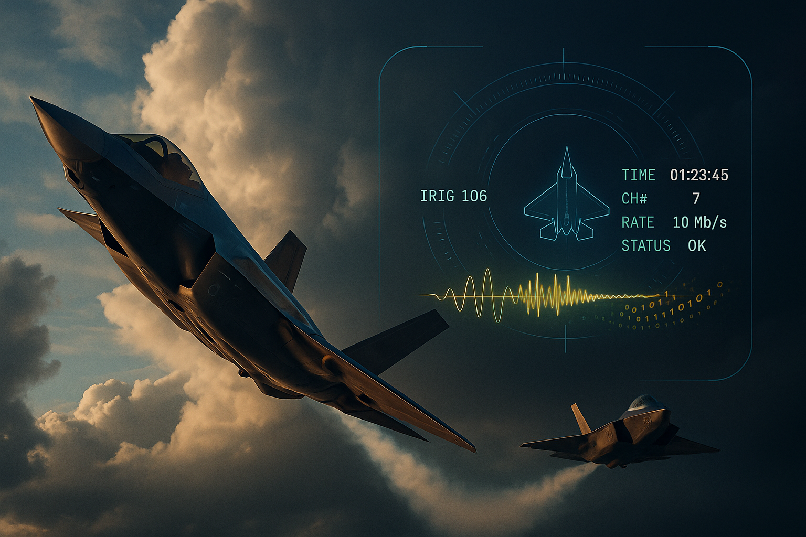

# ⚡TelemetryWorks  

**Flight meets code. Data meets truth.**

We build ruthless, high-performance telemetry tooling.  
  
IRIG-106. Ch10. PCM. Bus traffic. Sensor fusion. Edge compute.  
Rust first. Zero-copy. Deterministic. Crashproof.  
Because packets don’t care how you feel — only that you got them right.  

**Telemetry is a battlefield.**
**We ship tools built for it.**

## 🜂 What We Believe

We aren't here to reinvent telemetry.  
We’re here to **drag it into the future.**

> **Open source doesn’t mean hobby.**
> **It means we win together.**

* Real engineers. Real aircraft. Real missions.  
* Observability at Mach.  
* Verified timing or it didn’t happen.  
* Binary parsing is an art form.  
* **"It works on my machine" is not acceptable.**
* Everything testable. Everything traceable.  

We're not here to “disrupt.  
We’re here to **engineer like it matters** — because it does.  

## Goals

- ✅ Safe, modern, Rust-native telemetry stack  
- ✅ Zero-copy + async IO + streaming decode  
- ✅ Robust error handling (never crash on malformed data)
- ✅ Real-time & offline processing  
- ✅ Test-driven, spec-accurate decoders 

## 🧰 The Stack
**Rust crates, shaped like systems:**

```bash
irig106_ch10            # Core CH10 spec + packet defs
irig106_ch10_io         # mmap, async, streaming, zero-copy
irig106_ch10_parser     # decode engine + channel brains
irig106_ch10_index      # time-seek, random access, maps

```
If it runs on a range, test bench, or captured bus…  
we’ll make it readable, live, streamable, and weapon-grade reliable.  

## Philosophy  

- ✅ Production-ready  
- ✅ Fully test-covered  
- ✅ Standards-aligned  
- ✅ Rust safety and performance  
- ✅ Aerospace-grade reliability  
  
> Telemetry built for engineers who fly fast and test harder.

## 🏁 Who This Is For  

* Test pilots of software  
* Instrumentation gremlins  
* Range rats & telemetry ninjas  
* Autonomy devs who hate mystery data  
* Rustaceans who hate nonsense  
* People who know what IRIG sounds like at 3AM  

If your life has ever been ruined by timing drift, packet loss,  
or someone who “forgot to label the channel”…  
you’re one of us.  

## 🧪 Lab Culture  

* Break things in testing so they **never break in flight**  
* “Spec compliant” isn’t a goal — it’s the floor  
* CI checks what humans miss  
* Binary tools deserve beauty, too  
* Logs like poetry. Docs like truth serum.  
* **Telemetry is sacred**

## ⚙️ Contribute

We don’t need volume.  
We need **curious killers with taste.**

Open an issue. Submit a PR.  
Show us you can out-engineer the problem.  

If you don’t like rules, don’t worry:  
**physics enforces most of them for us.**  
